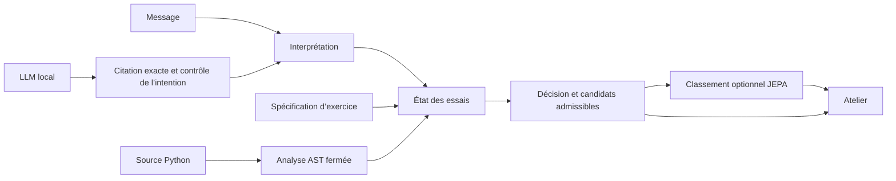

# P7 · Architecture pédagogique

`pedagogy/interpretation.py` traite les initiatives et les assertions. `pedagogy/cases.py` fixe la précondition, le résultat mathématique et la portée de l’analyse statique de chaque exercice. `pedagogy/workshop.py` fait évoluer le raisonnement à partir de ces preuves. `tutor/sessions.py` possède l’état, les conflits de tour, la réinitialisation d’énoncé et l’historique borné. Lors d’une modification de structure Python, l’essai précédent passe dans l’historique et ses acquis sont invalidés pour la version courante.

Quatre spécifications sont raccordées au catalogue. Le parcours P4–P6.2 reste accessible pour ses échanges historiques. Dans le guide, une demande d’explication ou de définition, un appel explicite de test ou une liste seule ouvre le parcours P7. En conversation, une initiative composée avec entrée et résultats peut aussi l’ouvrir au premier échange. Les conversations hors spécification conservent le parcours antérieur. Cette coexistence évite de transférer une preuve d’un protocole à l’autre. [Catalogue](../pedagogy/exercices.json) · [Orchestrateur](../pedagogy/workshop.py)

Le moteur local peut proposer une lecture d’un message ambigu en citant un segment. Le valideur vérifie la citation et le type avant de servir une explication ou une clarification rédigée. L’AST et les critères de l’exercice établissent les acquis. Dans ce chemin, le modèle n’écrit ni le verdict ni la sortie Python. Les modes existants conservent leurs sorties générées identifiées.

Les interventions progressent par reformulation, question ciblée, contre-exemple, indice de propriété et explication guidée. Des stratégies sont alternées pour un même cas et une même version. Si les questions disponibles sont épuisées, une explication prend le relais. Le plafond `--aide-max` vaut 4 par défaut. Avec le plafond 6, après trois demandes de corrigé et une explication confirmée, le tuteur peut donner le principe de correction. Avec le portable, arrêter l’instance avant de redémarrer avec `Demarrer.cmd --aide-max 6`. La configuration est locale à ce lancement.

Les 32 sessions et l’expiration de 45 minutes restent en place. Jusqu’à 10 essais anciens, 28 questions et 32 transitions sont conservés en mémoire. La classification du modèle reçoit une demande bornée, le cas résumé et l’objectif, sans historique intégral. Les traces de recherche sont exportées depuis des dialogues synthétiques. Les journaux du paquet restent des journaux de diagnostic. `Exécuter` reste indisponible tant qu’une isolation Windows n’est pas démontrée. L’atelier utilise les formes reconnues de l’AST au lieu d’exécuter les instructions de l’élève.
