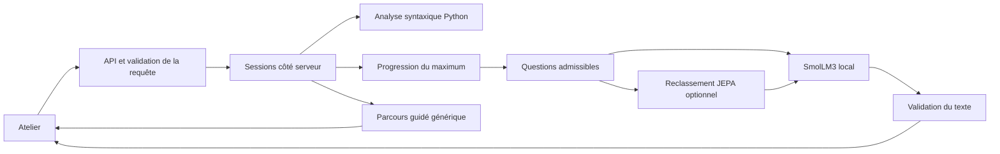

# P7 · Audit des causes

Base `5884996`, branche `main`. Les recettes P4, P5 et P6.2 attestent la progression du maximum de référence, les contrôles du moteur et le fonctionnement du paquet sur Windows Server. La capture P7 soumet une autre entrée au même exercice.

Le rejeu Chromium avec SmolLM3 et JEPA, sans réseau externe, classe la question libre `ambigue`. Il classe ensuite `maximum([-3, -4, -1])` `hors_sujet` et revient à `[-4, -2]`. [Trace du défaut](../p7/preuves/avant-chromium.jsonl) · [P4](RAPPORT-P4.md) · [P5](P5_RECETTE_FINALE.md) · [P6.2](TOUR_CONTEXTUEL.md)

| Défaut | Cause observée dans le code de départ | Conséquence |
| --- | --- | --- |
| A · Une demande « Pourquoi … ? » est dite insuffisante | `assess` applique à toute saisie la grille de la réponse précédente et traite un point d’interrogation final comme ambigu. | La difficulté formulée par l’élève reste sans explication. |
| B · `maximum([-3, -4, -1])` est rejeté | L’évaluation n’établit pas d’objet test, compare les listes à un littéral précis et connaît des questions écrites autour de deux entiers gelés. | Le test personnel disparaît. Le tuteur revient à `[-4, -2]`. |
| C · Rôles des résultats | Les verbes prédisant, déclarant et fixant le résultat attendu alimentent une même progression. | Une sortie déclarée peut se lire comme une preuve plus forte qu’elle ne l’est. |
| D · États différents selon la famille | Maximum possède un état, avec une liaison au tour précédent. Le guide générique déduit son niveau de chiffres, de verbes et d’une modification du code. | Des raisonnements hors maximum manquent de critères vérifiables. |
| E · LLM très contraint | Le moteur reçoit surtout l’intitulé de l’étape et une question de l’orchestrateur. La grammaire d’indice privilégie une courte phrase impérative et interdit beaucoup de formulations. | Le modèle peut reformuler une action, avec peu de place pour résoudre une ambiguïté ou expliquer. |
| F · Domaine JEPA | Les candidats sont bornés dans P5. Le modèle est entraîné sur des situations synthétiques. Un reclassement ne mesure pas un gain. | La disponibilité du moteur et l’utilité scientifique sont deux questions distinctes. |
| G · Exécution | L’éditeur et le serveur protègent la saisie par une analyse AST. Le bouton Exécuter est indisponible. | Une simulation statique de formes reconnues peut être ajoutée avec sa provenance. Pour une exécution générale, il manque une isolation démontrée sur Windows. |

`Sessions` protège la progression contre les déclarations du navigateur et borne l’historique. `analysis` fournit des constats statiques. La séparation proposée isole la lecture du message, les résultats démontrables d’une spécification et la décision pédagogique. La conservation du parcours historique est vérifiée par les tests P4 à P6.2.
